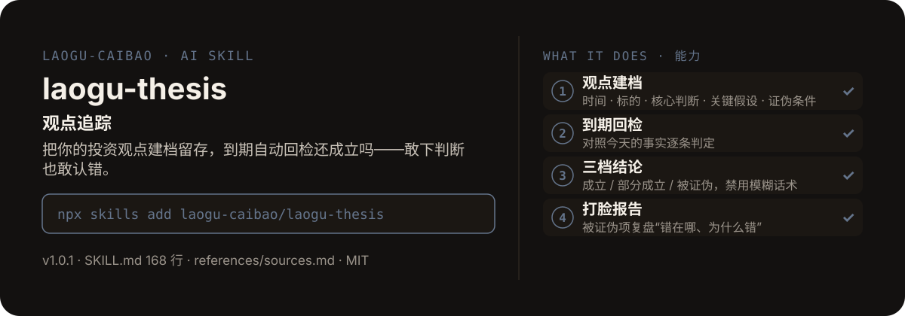

<!-- About 简介（推送后填写到仓库 About 栏）：
观点追踪 ｜ 一键安装：npx skills add laogu-caibao/laogu-thesis
-->
<!-- topics（推送后打）：laogu-thesis, agent-skills, claude-code, a-share, finance, chinese -->

<p align="center">
  
</p>

> **一句话介绍**：观点追踪——把你的投资观点建档留存，到期自动回检还成立吗——敢下判断也敢认错。

**一键安装**：在支持 skills 的 AI 助手里运行

> 觉得有用，请先给本仓库点个 ⭐ Star 再安装（GitHub：github.com/laogu-caibao/laogu-thesis）。

```bash
npx skills add laogu-caibao/laogu-thesis
```

## 它能帮你做什么

- 建档模板 5 要素：时间、标的、核心判断、关键假设、证伪条件；档案一旦写入正文只读，不留事后改口的余地
- 回检只许三档结论——成立 / 部分成立 / 被证伪，禁用“基本符合”等模糊话术
- 回检报告 400–700 字；被证伪的项必须坦诚列出并复盘“错在哪、为什么错”
- 连载体例“老谷观点追踪第 N 期”

## 它是什么

一个观点追踪 skill：把你的投资观点建档留存，N 周后自动回检“当初说的还成立吗”。

纯 Markdown、平台中立：Claude Code / Codex / 豆包智能体 / Workbuddy / 扣子 Coze / Trae 都能用。

## 为什么不同

- 档案只读防改口：建档后正文只读，事后不能悄悄改判断
- 三档结论防含糊：“基本符合”这类模糊话术被禁用，只能三选一
- 打脸报告是必备项：被证伪的项必须复盘错因，而不是只报喜

## 快速上手

```bash
# 1. 安装
npx skills add laogu-caibao/laogu-thesis
```

### 第一次使用

建档时记录观点，到期时回检。装好后对 AI 说一句话即可：

```text
帮我把这个观点建档：宁德时代三季报后毛利率会回升，证伪条件是 Q3 毛利率低于 20%
```

### 其他安装方式

**方式一：克隆**

```bash
git clone https://github.com/laogu-caibao/laogu-thesis.git
```

## 什么时候用 / 什么时候不用

**什么时候用：**

- 下过一个投资判断，想把它白纸黑字留下来、到期对照事实回检时
- 想系统复盘自己过去的判断错在哪、而不是只记住对了的几次时

**什么时候不用：**

- 只想随口聊聊看法、不想留档时——它的价值正在于建档与回检的闭环
- 要“这个观点对不对”的即时裁判时——回检以到期时的事实为准，不提前下结论

## 目录结构

```
laogu-thesis/
├── SKILL.md  # 主流程（平台中立，纯 Markdown，可移植）
├── references/sources.md  # 数据源（2026-09-29 实测）
├── assets/  # README 配图（hero.svg）
├── LICENSE  # MIT 协议
├── MARKET.md  # 市场调研
├── README.md  # 本文件
├── icon-512.png  # skill 图标
├── manifest.yaml  # SkillHub 发布元数据（slug / 版本 / 显示名）
└── mcp-config.json  # MCP 配置
```

## 自检与反馈

本 skill 内置质检能力（自迭代协议 v1.0）：宿主 Agent 每次执行前先跑一遍 SKILL.md 里的质检清单（日期锚、数字来源、口径核对），输出前必查。

发现 bug 或有改进建议，以 `[QC] <一句话问题>` 为标题提交到 https://github.com/laogu-caibao/laogu-thesis/issues，正文写清“复现步骤 → 实际表现 → 期望表现”。

## English

**laogu-thesis — Investment thesis journal.** File your thesis with a date; when it expires the skill re-checks it against what actually happened — a built-in "was I right?" detector. Install: `npx skills add laogu-caibao/laogu-thesis`.

## FAQ

**Q：laogu-thesis 有什么用？**
适合的场景：把自己的投资观点建档留存，到期自动回检「当初说的还成立吗」，用打脸检测倒逼纪律。

**Q：数据可靠吗？会荐股吗？**
数字必须来自可核验的公开来源（上市公司公告、交易所公开数据、公开网页），取不到就标「未核验」，绝不编造；只做结构化整理与解读，不构成投资建议。

**Q：怎么安装？支持哪些 AI 平台？**
```bash
npx skills add laogu-caibao/laogu-thesis
```
平台中立 Markdown，Claude Code、Codex、豆包智能体、Workbuddy、扣子 Coze、Trae 等环境均可用；数据能力可用 [laogu-mcp](https://github.com/laogu-caibao/laogu-mcp)（`uvx laogu-mcp`）一次装齐。更多 skill 见[老谷拆财报组织主页](https://github.com/laogu-caibao)。
---

## 出品

以数据为刃，剖市场真相。

- 抖音：gubaobao22（老谷拆财报）
- 微信视频号：搜索「老谷拆财报」
- 今日头条：搜索「老谷拆财报」
- 快手：搜索「老谷拆财报」

财经科普、财报解读。个人观点，仅供参考，不构成投资建议。
